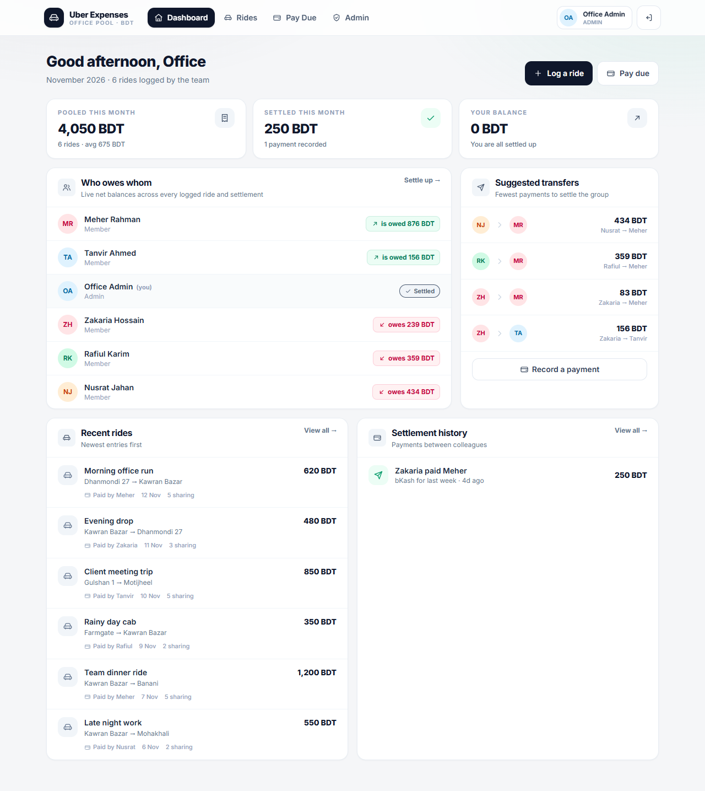
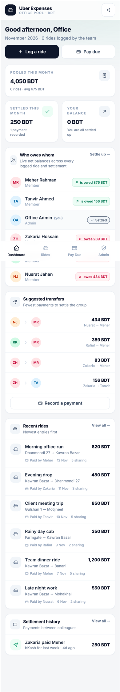
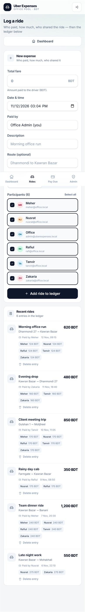

# 🚕 CoRide

A modern, lightweight, **mobile-first** web app for tracking and splitting daily Uber / ride-sharing expenses among a fixed group of office colleagues.

Log a ride once → everyone's share is calculated instantly → live "who owes whom" balances → record a payment and the ledger clears.



---

## Features

### 🔐 Authentication & approval workflow
- Email/password registration with **bcrypt-hashed** passwords
- **Admin approval required** — new signups stay in a *Pending* state and cannot reach the dashboard until an admin approves them (rejected users can re-apply)
- Session = **JWT in an httpOnly cookie** (7-day expiry, `SameSite=Lax`, `Secure` in production) — no token in `localStorage`
- Roles: `member`, `admin` and a fixed `system_admin` account — baseline accounts come from `server/init.sql`, never from app startup
- **Admin = system control only.** It approves/rejects signups, manages roles and can delete entries for oversight — but it is *never* a participant, payer, payee or balance row (see below)

### 📊 Dashboard & overview
- Total **pooled expenses for the current month**, settled total, and your own net balance
- Per-member balances phrased the way you asked for: *“Zakaria owes 239 BDT”* / *“Meher is owed 876 BDT”*
- **Suggested transfers** — every **direct** debt, grouped by the person who pays: *Asker → Imtiaz 100*, *Asker → Rafed 100* — exactly whom they actually borrowed from (pairs that cancel to 0 are hidden)
- Recent ride entries and settlement history

### ➕ Expense entry panel
- Date & time (defaults to now), total amount in BDT, description, route
- **Multiple payers** — tick as many members as split the bill and enter what each paid (live “Payers add up to X ✓” check; *Split evenly* one tap; amounts must equal the fare)
- Participants as checkboxes, **defaulting to every active member** — the admin account is excluded from this list
- **Equal split** (remainder distributed to the paisa so shares always add up exactly) or **Adjust shares** with a live “Remaining: 0 BDT ✓” check
- Instant ledger recalculation on submit; creators/admins can delete entries
- Admins see an explanatory empty state instead of the form (`POST /api/rides` → `403 ADMIN_READ_ONLY`)

### 💸 Settlement & payment tracking
- **Pay due / clear balance** — pick the colleague, amount (one-tap *suggested* payment), **payment method** (Cash · Bank · bKash · Nagad) and date
- Balance updates immediately; full history with undo
- **Recipient acknowledgement** — the pay-to user confirms "I received this" (`POST /api/settlements/:id/acknowledge`); every payment shows a status (*Awaiting confirmation* → *Confirmed*) with who confirmed it and when
- A amber callout on the Pay due page lists payments waiting for **your** confirmation
- Admins can review and undo any settlement, but can't record one themselves (`403 ADMIN_READ_ONLY`)

### 🛡 Admin panel
- Pending / Approved / Rejected / All tabs with live counts
- Approve · Reject · Reinstate · Grant/revoke admin (last admin can't be demoted)
- Amber banner nudges the admin whenever signups are waiting
- The admin is **not** a ledger user: it never appears in `/api/users`, participant pickers, payer/payee dropdowns, balances or suggested transfers — its own dashboard shows “Admin account — no balance” and links to this panel instead of *Log a ride* / *Pay due*

### 📱 Mobile-first design
- **Single-column base layouts** — `sm:` / `md:` / `lg:` only ever *add* columns
- 44 px minimum touch targets, **16 px inputs** (prevents iOS Safari focus-zoom)
- Fixed **bottom tab bar** on phones (with `env(safe-area-inset-bottom)`), top nav from `md:` up
- Horizontally scrollable filter tabs, wrapping action buttons, no horizontal scrolling anywhere

| Mobile (390 px) | |
|---|---|
|  |  |

---

## Tech stack

| Layer | Choice |
|---|---|
| Backend | **Node.js 20+** with **Express 5** (ESM) |
| Database | **SQLite** — [Turso Cloud](https://turso.tech) primary, local file fallback, via `@libsql/client` |
| Auth | `jsonwebtoken` (JWT) + `bcryptjs`, httpOnly session cookie |
| Frontend | **React 19** + **Vite 8** + **React Router 7** |
| Styling | **Tailwind CSS 4** (mobile-first utility classes, no component library needed) |
| Monorepo | npm workspaces + `concurrently` |

Money is stored as **integer paisa** (1 BDT = 100 paisa) end-to-end, so no float ever touches a balance.

---

## Project structure

```
uber-expenses/
├── package.json               # npm workspaces + dev/build/start scripts
├── .env.example               # copy to .env
├── docs/                      # README screenshots
│
├── server/                    # Express API
│   ├── package.json
│   ├── data/app.db            # local fallback SQLite file (git-ignored; used only when Turso vars are unset)
│   ├── init.sql               # baseline: accounts + metadata (idempotent)
│   ├── tests/smoke.mjs        # end-to-end API test suite
│   └── src/
│       ├── index.js           # app bootstrap, static serving, error handler
│       ├── config.js          # env loading + settings
│       ├── db.js              # DB client (Turso or local file) + startup ping — never inserts data
│       ├── initDb.js          # applies init.sql to Turso or the local file (npm run db:init)
│       ├── middleware/auth.js # requireAuth / requireApproved / requireAdmin
│       ├── lib/
│       │   ├── money.js       # paisa validation + BDT formatting
│       │   ├── datetime.js    # local timestamps + month keys
│       │   ├── users.js       # user queries + public serialization
│       │   └── balances.js    # ledger maths + min-transfer algorithm
│       └── routes/
│           ├── auth.js        # register / login / logout / me
│           ├── users.js       # approved member list
│           ├── rides.js       # expense entries
│           ├── settlements.js # payments
│           ├── dashboard.js   # overview payload
│           └── admin.js       # approval workflow + roles
│
└── client/                    # React SPA
    ├── package.json
    ├── vite.config.js         # Tailwind plugin + /api dev proxy
    ├── index.html
    └── src/
        ├── main.jsx / App.jsx # providers, route guards, routes
        ├── index.css          # Tailwind v4 theme + mobile base styles
        ├── lib/api.js         # fetch wrapper (cookie sessions, error mapping)
        ├── lib/format.js      # BDT/date/avatar formatting
        ├── context/           # AuthContext, ToastContext
        ├── components/        # Layout (header + bottom tab bar), ui.jsx primitives
        └── pages/             # Login, Register, Pending, Dashboard, Rides, Settle, Admin, NotFound
```

---

## Quick start

**Prerequisites:** Node.js **20.19+** (24 recommended) and npm 10+.

```bash
# 1. install everything (root install covers both workspaces)
npm install

# 2. optional: configure environment
cp .env.example .env          # Windows: copy .env.example .env

# 3. load the baseline data (accounts + payment methods/routes)
npm run db:init

# 4. run both API (:4000) and Vite dev server (:5173)
npm run dev
```

Open **http://localhost:5173** and sign in with an account from `server/init.sql`:

| Field | Value |
|---|---|
| Email | `admin@uberexpenses.local` |
| Password | `Admin@123` |

> The app **never creates data on startup** — every row comes from `init.sql` (applied by `npm run db:init`) or from users' own actions. `db:init` writes to **Turso** when `TURSO_DATABASE_URL` is set, otherwise to the local `DB_PATH` file. Change the admin password right after first login.

### Scripts

| Command | What it does |
|---|---|
| `npm run dev` | API + frontend together (hot reload) |
| `npm run server` / `npm run client` | One side only |
| `npm run build` | Production build of the React app → `client/dist` |
| `npm start` | Production mode: Express serves the API **and** the built SPA on `:4000` |
| `npm run db:init` | Apply `server/init.sql` (baseline accounts + metadata; idempotent) |
| `npm run test:api` | End-to-end API suite (server must be running) |

### Environment variables

| Variable | Default | Notes |
|---|---|---|
| `PORT` | `4000` | API/port for the merged production server |
| `NODE_ENV` | `development` | Set `production` to enable `Secure` cookies |
| `JWT_SECRET` | dev default | **Required in production** — `node -e "console.log(require('crypto').randomBytes(48).toString('hex'))"` |
| `TURSO_DATABASE_URL` | — | Turso DB URL (`libsql://…`). When set, the server uses **Turso Cloud and ignores `DB_PATH`** |
| `TURSO_AUTH_TOKEN` | — | Turso auth token (paired with `TURSO_DATABASE_URL`) |
| `DB_MODE` | — | `local` forces the local `DB_PATH` file even when Turso vars are set (use this for tests) |
| `DB_PATH` | `server/data/app.db` | Local SQLite file (absolute path or `:memory:`) — used **only when `TURSO_DATABASE_URL` is unset or `DB_MODE=local`** |
| `CLIENT_ORIGIN` | `http://localhost:5173` | CORS origin for split-origin dev setups |

---

## How the balances work

Every ride and settlement adjusts a single integer ledger:

```
net(user) =  Σ paid amounts  −  Σ personal shares  +  Σ received payments  −  Σ payments made
```

- `net > 0` → **is owed money**
- `net < 0` → **owes money**
- `net = 0` → settled

The dashboard then lists **direct (pairwise) debts** straight from the ledger:

- Each ride records *who owes whom*: every participant's share in `ride_shares` is split across that ride's `ride_payers` proportionally to what each payer contributed, and settlements shrink those IOUs.
- When one member paid, it's a single direct IOU to them. When several split the bill, each participant owes every payer their portion — e.g. *Asker → Imtiaz 75*, *Asker → Rafed 50* on a ride Imtiaz and Rafed paid 3:2.
- Opposite IOUs between two people cancel each other — if Rafed owes Imtiaz 100 for the morning ride and Imtiaz owes Rafed 100 for the evening ride, the pair nets to **0 and is hidden**.
- Nothing is re-routed through an intermediary: debts always point straight at whoever actually paid.
- The allocation is exact to the paisa: applying every suggested transfer to the balance ledger clears every member's net to 0.

Splits: `amount_paisa` is divided with `floor` and the remainder is handed out one paisa at a time, so custom and equal shares **always sum to the total** (the API rejects a mismatch).

---

## API reference

All endpoints are prefixed with `/api`. `🔐` = requires a session, `👮` = requires an **approved** account, `👑` = requires **admin**.

| Method | Endpoint | Access | Body / query |
|---|---|---|---|
| `GET` | `/api/health` | public | – |
| `POST` | `/api/auth/register` | public | `{ name, email, password }` → `201`, user is `pending` |
| `POST` | `/api/auth/login` | public | `{ email, password }` → sets cookie; `403 REJECTED` if rejected |
| `POST` | `/api/auth/logout` | 🔐 | clears cookie |
| `GET` | `/api/auth/me` | 🔐 | current user (any status) |
| `GET` | `/api/users` | 👮 | approved **members** (participant pickers) — admin excluded |
| `POST` | `/api/rides` | 👮 member | `{ paidBy? \| payers[], amountPaisa, description, route?, rideAt?, splitMethod, participants[], shares? }` — `paidBy` = one payer for the whole fare; `payers: [{ userId, amountPaisa }]` = split payment (must sum to `amountPaisa`, else `400 PAYERS_MISMATCH`); admin → `403 ADMIN_READ_ONLY` |
| `GET` | `/api/rides` | 👮 | `?limit=` newest first |
| `DELETE` | `/api/rides/:id` | 👮 | creator or admin (oversight) |
| `POST` | `/api/settlements` | 👮 member | `{ toUser, amountPaisa, paymentMethod: cash\|bank\|bkash\|nagad, settledAt?, fromUser? (admin) }` — admin → `403 ADMIN_READ_ONLY` |
| `GET` | `/api/settlements` | 👮 | `?limit=` newest first — rows include `paymentMethod`, `status` (`pending`\|`acknowledged`), `acknowledgedAt` |
| `POST` | `/api/settlements/:id/acknowledge` | 👮 | pay-to user confirms receipt → `200`; others → `403 NOT_RECIPIENT`; already confirmed → `409 ALREADY_ACKNOWLEDGED` |
| `DELETE` | `/api/settlements/:id` | 👮 | recorder or admin (oversight) |
| `GET` | `/api/dashboard` | 👮 | month totals, balances, `transfers` (direct debts), recent activity — admin filtered out of `balances`/`transfers` |
| `GET` | `/api/admin/users` | 👑 | `?status=pending\|approved\|rejected\|all` |
| `POST` | `/api/admin/users/:id/approve` | 👑 | unlocks the dashboard |
| `POST` | `/api/admin/users/:id/reject` | 👑 | blocks an account (re-application allowed) |
| `POST` | `/api/admin/users/:id/role` | 👑 | `{ role: "admin" \| "member" }` |
| `GET` | `/api/admin/stats` | 👑 | user counts + lifetime ride total |

Example — log a 450 BDT ride split three ways (amounts are **paisa**):

```bash
curl -X POST http://localhost:4000/api/rides \
  -H 'Content-Type: application/json' \
  -b cookies.txt \
  -d '{
    "paidBy": 3,
    "amountPaisa": 45000,
    "description": "Morning office run",
    "route": "Dhanmondi to Kawran Bazar",
    "splitMethod": "equal",
    "participants": [2, 3, 5]
  }'
```

Two members splitting the payment (300 BDT paid by Imtiaz, 150 BDT by Rafed):

```bash
curl -X POST http://localhost:4000/api/rides \
  -H 'Content-Type: application/json' \
  -b cookies.txt \
  -d '{
    "payers": [{ "userId": 2, "amountPaisa": 30000 }, { "userId": 3, "amountPaisa": 15000 }],
    "amountPaisa": 45000,
    "splitMethod": "equal",
    "participants": [2, 3, 5]
  }'
```

Ride payloads carry `payers: [{ userId, name, amountPaisa }]` (plus `paidBy` = the biggest payer, kept for compatibility).

Errors always look like `{ "error": "human readable message", "code": "MACHINE_CODE" }`.

---

## Database schema

```sql
users (
  id            INTEGER PK AUTOINCREMENT,
  name          TEXT NOT NULL,
  email         TEXT NOT NULL UNIQUE (case-insensitive),
  password_hash TEXT NOT NULL,               -- bcrypt
  role          TEXT 'admin' | 'member',
  status        TEXT 'pending' | 'approved' | 'rejected',
  created_at    TEXT, approved_at TEXT
)

rides (
  id           INTEGER PK,
  paid_by      INTEGER → users,             -- primary (biggest) payer, legacy readers
  amount_paisa INTEGER > 0,
  description  TEXT,
  route        TEXT,
  ride_at      TEXT,                        -- local "YYYY-MM-DDTHH:mm"
  split_method TEXT 'equal' | 'custom',
  created_by   INTEGER → users,
  created_at   TEXT
)

ride_shares (
  ride_id     INTEGER → rides (CASCADE),
  user_id     INTEGER → users (CASCADE),
  share_paisa INTEGER ≥ 0,
  PRIMARY KEY (ride_id, user_id)
)

ride_payers (                               -- one row per payer; sums to amount_paisa
  ride_id      INTEGER → rides (CASCADE),
  user_id      INTEGER → users (CASCADE),
  amount_paisa INTEGER > 0,
  PRIMARY KEY (ride_id, user_id)
)

settlements (
  id              INTEGER PK,
  from_user       INTEGER → users,             -- who paid
  to_user         INTEGER → users,             -- who received
  amount_paisa    INTEGER > 0,
  payment_method  TEXT 'cash'|'bank'|'bkash'|'nagad',
  settled_at      TEXT, recorded_by INTEGER → users,
  acknowledged_at TEXT,                        -- set by to_user; NULL = awaiting confirmation
  CHECK (from_user <> to_user)
)
```

---

## Deployment

The production server is **one service**: Express serves the built SPA from `client/dist`, so there is no CORS/cookie juggling in production.

### Render (recommended, free tier)

Push the repo to GitHub, then either:

- **Blueprint (easiest):** the included `render.yaml` defines build/start commands, health check and env-var stubs — Render → **New → Blueprint** → pick the repo, then paste `TURSO_DATABASE_URL` / `TURSO_AUTH_TOKEN` when prompted, or
- **Manual:** Render → **New → Web Service** from the repo, with the settings below.

Settings (manual route):

- **Build command:** `npm install && npm run build`
- **Start command:** `npm run db:init && npm start`
- **Node version:** set env `NODE_VERSION=24` (Render) or keep `engines.node` in `package.json` (20.19+ required)
- **Environment variables:** `NODE_ENV=production`, a strong `JWT_SECRET`, and the Turso pair `TURSO_DATABASE_URL` + `TURSO_AUTH_TOKEN` (recommended).
- **Persistence:**
  - **With Turso configured (recommended):** nothing to persist locally — `init.sql` and all app data live in Turso Cloud, so ephemeral disks don't matter. `npm run db:init` in the start command applies the baseline to Turso (idempotent, safe on every deploy).
  - **Without Turso:** Render's free filesystem is *ephemeral* — the SQLite file is wiped on redeploy/restart. Either attach a **Disk** (Render → Disks, e.g. mount at `/var/data`) and set `DB_PATH=/var/data/app.db`, or accept the reset for a demo.
- Open the assigned `*.onrender.com` URL → log in with an account from `init.sql`.

### Railway

Same build/start commands; with Turso configured no volume is needed — otherwise add a **Volume** and point `DB_PATH` at it. Free plans include limited persistent volume hours.

### Vercel + Neon (port required)

Vercel's serverless filesystem can't host a long-lived Express process with a SQLite file, so this repo targets Render/Railway out of the box. To move to Vercel:

1. Split `server/src` into Vercel serverless functions (one per router) or wrap it with `@vercel/node`.
2. Swap the data layer: `server/src/db.js` and `server/src/lib/*` are the only files that touch storage — port them to `pg` + Neon (the SQL is standard except SQLite's `substr`/`datetime` helpers).
3. Deploy `client/` as a Vercel project with `VERCEL_API_URL` pointed at the API, and set `JWT_SECRET` + `DATABASE_URL`.

### Docker (optional)

```dockerfile
FROM node:24-alpine AS build
WORKDIR /app
COPY . .
RUN npm install && npm run build

FROM node:24-alpine
WORKDIR /app
COPY --from=build /app .
ENV NODE_ENV=production
EXPOSE 4000
CMD ["npm", "start"]
```

---

## Testing

```bash
# DB_MODE=local forces the local file even though TURSO_* is set in .env
DB_MODE=local DB_PATH=./data/test.db npm run db:init             # once per fresh test DB
DB_MODE=local DB_PATH=./data/test.db PORT=4100 npm run server    # terminal 1
BASE_URL=http://localhost:4100 npm run test:api                  # terminal 2
```

The suite covers the whole workflow: guards → registration → pending lockout → admin approval → ride creation (equal **and** custom splits) → balances netting to zero → settlements (payment method validation, recipient-only acknowledgement, double-ack 409) → delete permissions → rejection/re-application → logout, plus the **admin-is-system-only** rules (admin excluded from `/api/users`, `403 ADMIN_READ_ONLY` on ride/settlement creation, admin filtered out of the balance ledger).

> It writes its own test users, so it must run against a throwaway database — never the live one.
> While `TURSO_DATABASE_URL` is set, `DB_PATH` is ignored — set **`DB_MODE=local`** to force the local file.
> PowerShell: `$env:DB_MODE='local'; $env:DB_PATH='./data/test.db'; $env:PORT=4100`

---

## Security notes

- Passwords hashed with **bcrypt** (cost 10)
- JWT signed with `JWT_SECRET`, verified on **every** request (role/status changes apply immediately)
- Session cookie is `httpOnly` + `SameSite=Lax`, `Secure` when `NODE_ENV=production`
- Status/role checks happen on the **server** for every data route — hiding UI is never the only guard
- Parameterised queries throughout (`@libsql/client` prepared statements), JSON body limited to 256 kB
- Admin actions are protected from self-rejection and last-admin demotion

---

## License

MIT — use it for your office pool. 🎉
